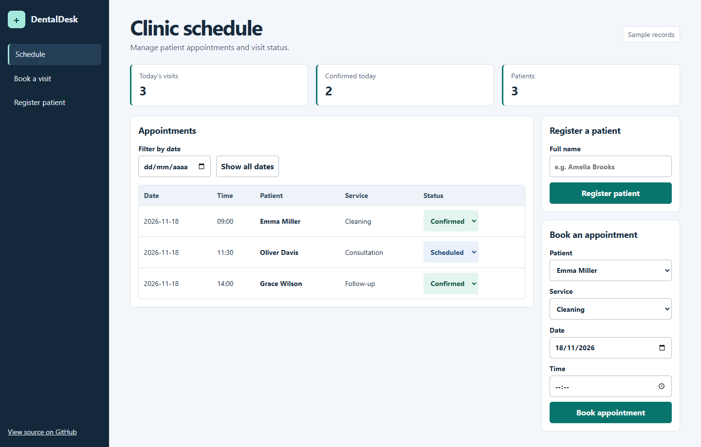

# DentalDesk

A dental practice scheduling demo. Built with Angular.

Register sample patients, book appointments, filter the schedule by date, and update visit status. Booking validation prevents duplicate appointments in the same time slot.

The demo uses fictional records and stores changes in the browser.



[Patient booking prototype](https://wesbertolaia.github.io/dentaldesk/patient.html) · [Offer variant](https://wesbertolaia.github.io/dentaldesk/patient.html?offer=times) · [Clinic workspace](https://wesbertolaia.github.io/dentaldesk/)

The patient-facing prototype shows sample times before the request step. The second offer changes the headline and first action while keeping the flow constant.

## Browse the code

- [Clinic workspace](./dentaldesk.js)
- [Patient booking flow](./patient.js)
- [Browser storage and date utilities](./storage.js)

## Run the demo locally

Use Node.js 24.

```sh
npm ci
npm run build
npm start
```

Open http://localhost:4173.
